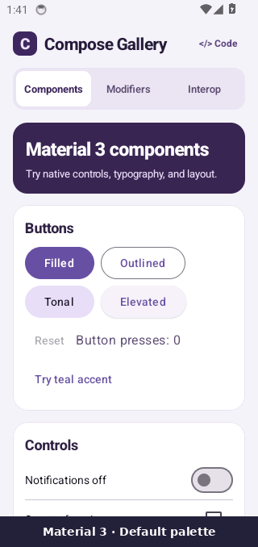

# Jetpack Compose React Native

Use native Jetpack Compose and Material 3 components from TypeScript in your
React Native Android app. The library generates component and modifier bindings
from AndroidX, and a top-level Compose component hosts its subtree automatically.

## Quick start

Install the package or a checkout of this repository in a React Native 0.74.5
app with the New Architecture enabled, then rebuild Android. React Native
autolinks the view managers and Fabric descriptors.

```tsx
import { Pressable, Text as RNText } from "react-native";
import { Button, Column, Modifier, Text } from "jetpack-compose-react-native";

export function Greeting() {
  return (
    <Column
      modifiers={Modifier
        .background("#ede5fc", { in: { rect: { cornerRadius: 16 } } })
        .padding("all", 16)}
    >
      <Text text="Hello from Compose" />
      <Button onClick={() => console.log("Compose clicked")}>
        <Text text="Compose button" />
      </Button>
      <Pressable onPress={() => console.log("React Native clicked")}>
        <RNText>React Native button</RNText>
      </Pressable>
    </Column>
  );
}
```

Generated components accept the `modifiers` prop, and chains start with
`Modifier`. Modifier order matters. For example, putting `background` before
`padding` paints the padded area. See the [code generation guide](tools/compose-codegen/README.md)
for package discovery, supported argument types, and regeneration.

## Customize the theme

Wrap a Compose subtree in `MaterialTheme` and pass a Material 3 color scheme.
Theme values apply to Material components inside that subtree.

```tsx
import { useColorScheme } from "react-native";
import { Button, MaterialTheme, Text, darkColorScheme, lightColorScheme } from "jetpack-compose-react-native";

const light = lightColorScheme({ primary: "#005e54", onPrimary: "#ffffff" });
const dark = darkColorScheme({ primary: "#80d5c6", onPrimary: "#003730" });

function ThemedButton() {
  const colors = useColorScheme() === "dark" ? dark : light;
  return (
    <MaterialTheme colorScheme={colors}>
      <Button onClick={() => console.log("Continue")}>
        <Text text="Continue" />
      </Button>
    </MaterialTheme>
  );
}
```

`MaterialTheme` can be the root of a Compose subtree or nested inside one.
Omit `colorScheme` to inherit the parent palette or use the native defaults.

## Compose Gallery



Use the three tabs in the [example app](example/App.tsx) to explore the bridge.

| Tab | What to try |
| --- | --- |
| **Components** | Compare button variants, change switches and selection controls, type into a field, and open a native alert dialog. |
| **Modifiers** | Reverse the padding and background chain. Compare gradients, borders, clipping, shadows, and weighted row children. |
| **Interop** | Tap the Compose button, the React Native button, or the count itself. Odd counts insert a React Native child inside Compose and push the view below it down. |

Tap **Code** to show the TypeScript used in each demo.

### Run the gallery

Use Node 22, JDK 17, and an API 34 emulator or Android device. With the Android
SDK command-line tools installed and `ANDROID_HOME` set, install the required
packages.

```sh
sdkmanager "platform-tools" "platforms;android-34" "build-tools;34.0.0" \
  "ndk;26.1.10909125" "cmake;3.22.1"
```

Start the emulator or connect a device, then run these commands from the
repository root.

```sh
adb devices
npm ci
npm run android
```

The command builds, installs, and launches the gallery. Set `ANDROID_SERIAL`
when multiple devices are connected. With Python 3 installed,
`npm run android:verify` also checks gallery navigation, modifier order, and
mixed Compose and React Native interactions on the device.
